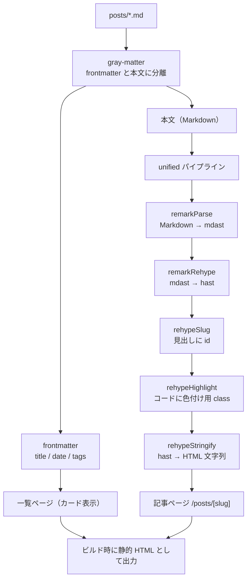
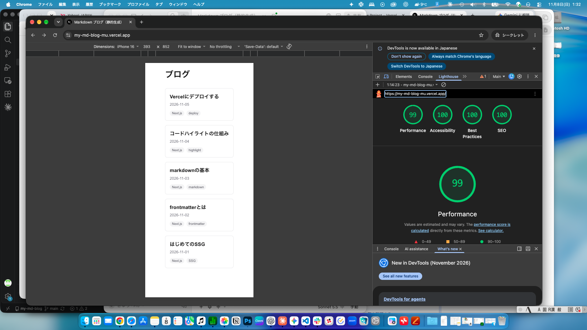
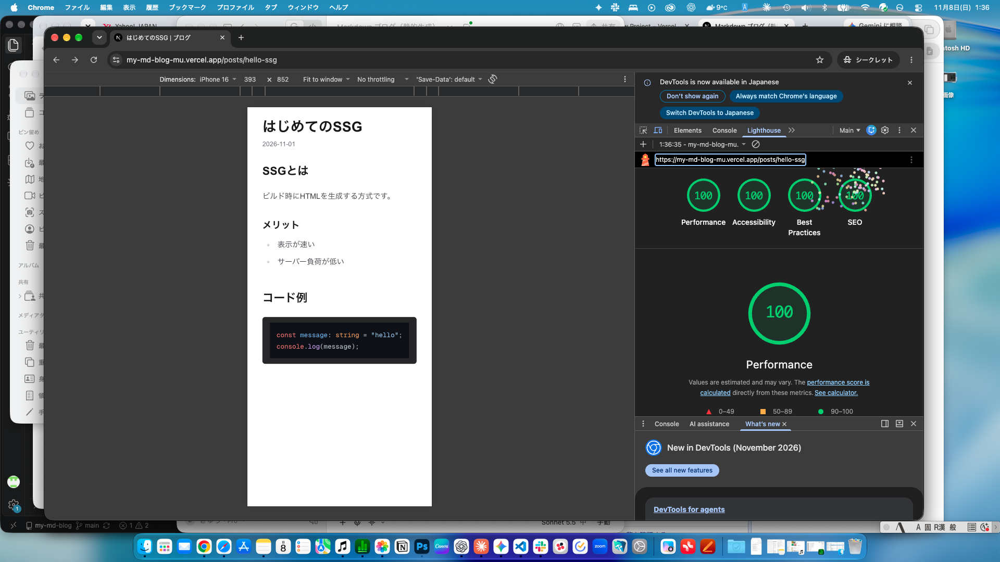

# Markdown ブログ（静的生成）

Next.js の **SSG（Static Site Generation）** で作った、Markdown ベースの軽量ブログです。`posts/` に置いた `.md` ファイルから、一覧ページと記事ページをビルド時に HTML として生成します。WordPress の代わりに軽量な CMS が欲しい、という Web 制作の依頼を想定した課題として制作しました。

- **公開 URL**：https://my-md-blog-mu.vercel.app
- **リポジトリ**：https://github.com/team-pharma-d/my-md-blog
- **学習ノート**：[docs/learning-note.md](docs/learning-note.md)

## 達成したこと

- [x] `posts/` の `.md` を5本配置して `next build` が通る（記事5本が静的 HTML として生成された）
- [x] `/posts/[slug]` で見出し階層（h2 / h3）が正しく表示される
- [x] Lighthouse の Performance が 90 以上（一覧 99 / 記事 100、モバイル・本番 URL で計測）

加えて、次を実装しました。

- frontmatter（title / date / tags）のパースと、カード形式の一覧表示（日付の新しい順）
- コードブロックのシンタックスハイライト
- 記事ごとの `title` / `description`（`generateMetadata`）と `<html lang="ja">`

## 技術スタックと選定理由

| 技術 | 用途 | 選んだ理由 |
|---|---|---|
| Next.js 16（App Router） | フレームワーク・SSG | `generateStaticParams` で記事ページをビルド時に生成できる |
| TypeScript | 言語 | 記事データの型（`PostMeta`）を定義でき、取り違えに気づきやすい |
| gray-matter | frontmatter のパース | md を frontmatter と本文に分離する定番ライブラリ |
| unified / remark / rehype | Markdown → HTML 変換 | 変換を段階に分けて組み立てられ、見出し id やハイライトをプラグインで足せる |
| Tailwind CSS v4 + typography | スタイリング | `prose` クラスで、md 由来の HTML を簡単に整えられる |
| highlight.js（rehype-highlight） | コードの色付け | コードブロックの言語を自動で判定して色付けできる |
| Vercel | ホスティング | GitHub 連携で、push するだけで公開できる |

## 処理の流れ

ビルド時に、md から完成済みの HTML までをすべて作ります。ブラウザからの要求には、できあがった HTML を返すだけです。



## 検証結果

### ビルド（`npm run build`）

```
Route (app)
┌ ○ /
├ ○ /_not-found
└   /posts/[slug]
  ├ ● /posts/code-highlight
  ├ ● /posts/deploy-to-vercel
  ├ ● /posts/hello-ssg
  └ ● [+2 more paths]

○  (Static)  prerendered as static content
●  (SSG)     prerendered as static HTML (uses generateStaticParams)
```

- `Generating static pages (9/9)`：ビルド時に9ページを生成
- 記事5本がすべて `●（SSG）`
- 生成物 `.next/server/app/posts/hello-ssg.html` に、見出しの `id` やハイライト用の class が書き込まれた状態の HTML があることを確認

### Lighthouse（本番 URL・モバイル・シークレットウィンドウ）

| ページ | Performance | Accessibility | Best Practices | SEO |
|---|---|---|---|---|
| 一覧（`/`） | 99 | 100 | 100 | 100 |
| 記事（`/posts/hello-ssg`） | 100 | 100 | 100 | 100 |

| 一覧ページ | 記事ページ |
|---|---|
|  |  |

高いスコアの理由：HTML をビルド時に完成させているため、実行時に md の読み込みや変換が発生せず、画像もほとんど使っていないためです。

## ディレクトリ構成

```
my-md-blog/
├─ app/
│   ├─ layout.tsx            # 全ページ共通の枠・サイト全体のメタタグ
│   ├─ page.tsx              # 一覧ページ
│   ├─ globals.css           # Tailwind と typography プラグインの設定
│   └─ posts/[slug]/page.tsx # 記事ページ（generateStaticParams / generateMetadata）
├─ lib/
│   └─ posts.ts              # md の読み込み・変換（getPostSlugs / getAllPosts / getPostBySlug）
├─ posts/                    # 記事（Markdown）
├─ docs/
│   ├─ learning-note.md      # 学習ノート
│   └─ images/               # 検証結果のスクリーンショット
└─ package.json
```

## ローカルでの動かし方

```bash
git clone https://github.com/team-pharma-d/my-md-blog.git
cd my-md-blog
npm install
npm run dev      # 開発サーバー（表示された URL にアクセス）
npm run build    # 本番ビルド（SSG の確認）
npm run start    # ビルド結果を本番モードで起動
```

記事を追加するときは、`posts/` に `.md` ファイルを置き、先頭に次の frontmatter を書きます。ファイル名がそのまま URL の slug になります。

```md
---
title: "記事のタイトル"
date: "2026-11-01"
tags: ["Next.js", "SSG"]
---
```

## 工夫した点

- 目次（TOC）を、見出しの id から自動生成して記事ページに表示した
- md → HTML の変換を `unified` のパイプラインにして、見出し id（`rehypeSlug`）とコードの色付け（`rehypeHighlight`）をプラグインで追加できる構成にした
- 一覧用（frontmatter だけ）と記事用（HTML 変換まで）で関数を分け、一覧の生成で無駄な変換をしない
- 記事ごとの `title` / `description` を `generateMetadata` で出し分け、SEO スコア 100 を確認した
- 開発中に出たエラーの原因と対処を、[学習ノート](docs/learning-note.md)の「つまずきと解決」に記録した

## 今後の改善

- タグ別の一覧ページ、タグの表記ルールの整備
- frontmatter に記事の要約（description）を追加し、メタタグに反映
- RSS フィード、サイトマップの生成
- md のコードブロック以外（画像など）の最適化
