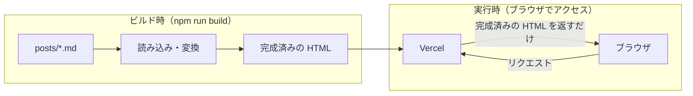
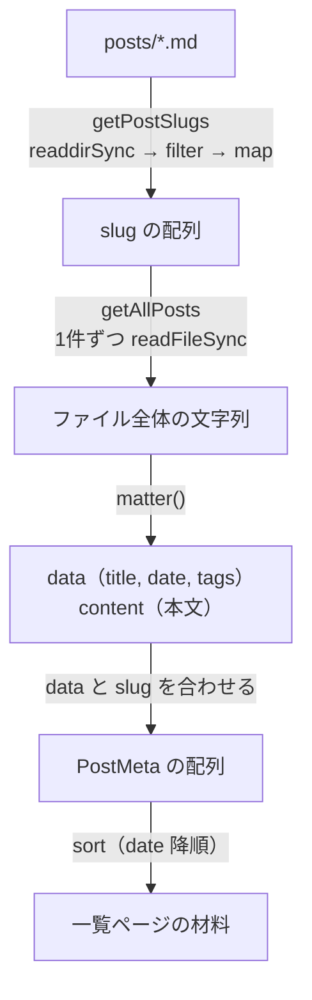
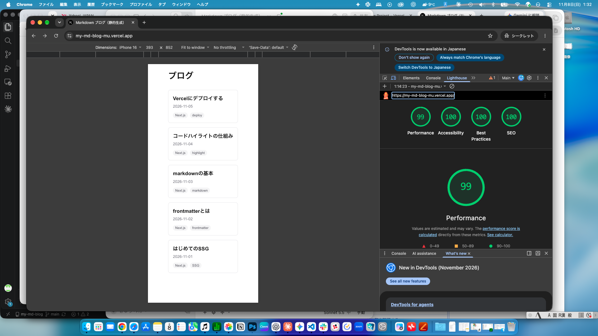
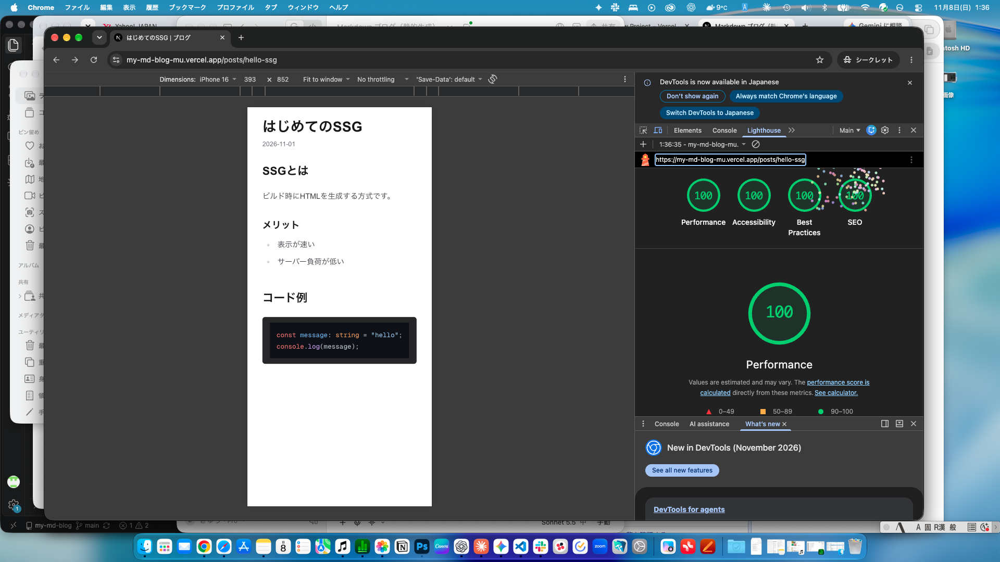

# 学習ノート：Next.js で作る Markdown ブログ（SSG）

## 1. この課題の目的
- Web 制作の依頼には「WordPress の代わりに、軽量な CMS が欲しい」というものが一定数ある。その典型的な解決策が、静的サイト生成（SSG）で作る Markdown ブログである
- 目的は、`posts/` の md ファイルから、一覧ページと記事ページをビルド時に HTML として生成する仕組みを、自分の手で作って理解すること
- 達成基準：① md 5本で `next build` が通る　② `/posts/[slug]` で見出し階層が正しく表示される　③ Lighthouse の Performance が 90 以上
- 今回は、AI に答えを書かせず、手順に沿って自分で書いて動かすことを優先した。URL 設計・メタタグ・tags の運用ルールは自分で判断した

## 2. SSG とは

### 2-1. SSG / SSR / CSR の違い
| 方式 | HTML を作る場所とタイミング | 特徴 |
|---|---|---|
| SSG（Static Site Generation） | サーバー側で、**ビルド時**に全ページ分を先に作る | 表示が速い。サーバーの負荷が低い。内容の更新には再ビルドが必要 |
| SSR（Server-Side Rendering） | サーバー側で、**リクエストのたび**に作る | 常に最新の内容を出せる。サーバーの処理が毎回必要で、SSG より遅くなりやすい |
| CSR（Client-Side Rendering） | **ブラウザ**で JavaScript が作る | 画面の操作に強い。最初の表示が遅くなりやすく、SEO に不利なことがある |

今回のブログは、記事が頻繁に変わらず、全員に同じ内容を見せればよいので、SSG が向いている。

### 2-2. ビルド時と実行時で何が行われるか
- **ビルド時**（`npm run build`）：md を読み込み、frontmatter を分離し、HTML に変換して、完成済みのページを書き出す。仕事の大半はここで終わる
- **実行時**（ブラウザでアクセスしたとき）：できあがった HTML を返すだけ。md の読み込みも変換も行わない

これが、SSG が速く、Lighthouse で高いスコアを出しやすい理由である。実際に `.next/server/app/posts/hello-ssg.html` を開き、見出しの `id` やコードの色付け用 class が、すでに書き込まれていることを確認した（9章）。



## 3. 環境構築で学んだこと
### 3-1. create-next-app の選択肢
| 質問 | 選択 | 理由 |
|---|---|---|
| React Compiler | No | React のコードを自動最適化する機能。今回は全ページをビルド時に HTML にする SSG が中心で効果が薄く、エラーの切り分けも難しくなるため不要 |
| Cache Components | No | ページの一部をキャッシュ／動的に出し分ける機能。今回は全ページ静的生成なので不要。有効にすると `params` などの扱いが変わる可能性がある |
| AGENTS.md | No | AI エージェント向けの指示ファイル。自分で手を動かして書く方針なので不要 |

### 3-2. ポート番号（3000 / 3001）
- ポート：パソコン内でアプリごとに通信の入り口を分ける番号
- `npm run dev` は通常 3000 番を使うが、他のアプリが使用中だと Next.js が自動で次の空き番号（3001）に切り替える
- ターミナルに `Port 3000 is in use by process ○○, using available port 3001 instead.` と表示される
- 対処：ターミナルに表示された URL（`Local: http://localhost:3001`）にアクセスすればよい

## 4. App Router とファイル構成

### 4-1. App Router
`app/` 以下のフォルダ構成が、そのまま URL になる仕組み。

| ファイル | URL | 役割 |
|---|---|---|
| `app/page.tsx` | `/` | 一覧ページ |
| `app/posts/[slug]/page.tsx` | `/posts/hello-ssg` など | 記事ページ |

### 4-2. layout.tsx と page.tsx の違い
- `layout.tsx`：**全ページ共通の枠**。`<html>` や `<body>`、サイト全体のメタタグを持つ。中の `{children}` に、各ページの `page.tsx` の中身が差し込まれる
- `page.tsx`：そのURL**固有の中身**

### 4-3. 動的ルート `[slug]`
- フォルダ名を `[slug]` のように角括弧にすると、URL の可変部分を表す。`/posts/hello-ssg` なら `slug = "hello-ssg"`
- 1つのファイルで、記事の数だけページを作れる
- SSG では、ビルド時にどの slug を作るかを `generateStaticParams` で Next.js に教える（7-2）

### 4-4. Server Component
`app/` のコンポーネントは、デフォルトで **Server Component**（サーバー側で実行される）。そのため `fs`（ファイル読み込み）が使え、`console.log` の出力もブラウザではなくターミナルに出る（5-4）。

## 5. 記事データの読み込み（lib/posts.ts）

`lib/posts.ts` に 3 つの関数を作った。

| 関数 | 返すもの | 使う場所 |
|---|---|---|
| `getPostSlugs()` | slug の配列 | 詳細ページの `generateStaticParams`（Step 7） |
| `getAllPosts()` | 全記事の slug / title / date / tags（日付の新しい順） | 一覧ページ（Step 6） |
| `getPostBySlug(slug)` | 1 記事の情報 + HTML に変換した本文 | 詳細ページ（Step 7） |

### 5-1. getPostSlugs
`posts/` フォルダのファイル名から、記事の識別名（slug）の一覧を作る。

1. `fs.readdirSync(postsDirectory)`：フォルダ内のファイル名を配列で取得
2. `.filter((name) => name.endsWith(".md"))`：`.md` で終わるものだけ残す（`.DS_Store` などを除外）
3. `.map((name) => name.replace(".md", ""))`：末尾の `.md` を取り除く

```
["hello-ssg.md", ...]  →  ["hello-ssg", ...]
```

ファイル名がそのまま URL の slug（`/posts/hello-ssg`）になる。

### 5-2. getAllPosts
- `matter(文字列)` は、md を **`data`（frontmatter をオブジェクトにしたもの）** と **`content`（本文の Markdown）** に分ける。この「文字列 → 構造のあるデータ」への変換が**パース**
- `getAllPosts` は一覧表示用なので `data` だけを使う
- `slugs.map(...)` で 1 件ずつ読み、`{ slug, title, date, tags }` のオブジェクトにする
- `sort((a, b) => b.date.localeCompare(a.date))` で日付の新しい順に並べる。日付が `"2026-11-05"` の形式なので、文字列比較でも新旧を正しく判定できる
- 確認：`sort` を入れる前は slug のアルファベット順、入れた後は日付降順になった

### 5-3. 処理の流れ（図）



### 5-4. console.log はターミナルに出る
`console.log` の出力はブラウザではなく、`npm run dev` を実行しているターミナルに出た。`app/page.tsx` が Server Component（サーバー側で実行されるコンポーネント）であることの確認になった。

## 6. Markdown → HTML 変換（remark / rehype）

### 6-1. getPostBySlug の中身
1. `readFileSync` で md を読む
2. `matter()` で `data` と `content` に分ける
3. `unified()` のパイプラインで `content`（Markdown）を HTML に変換する
4. `{ slug, title, date, tags, html }` を返す

変換は時間のかかる非同期処理なので、`async` 関数にして `await ... .process(content)` で完了を待つ。呼び出す側にも `await` が必要。

### 6-2. unified のパイプライン
`unified` は、部品（プラグイン）を `.use()` で順番につなぐ「流れ作業のライン」。

| プラグイン | 役割 | 入力 → 出力 |
|---|---|---|
| `remarkParse` | Markdown の文字列を構文木にする | 文字列 → mdast |
| `remarkRehype` | Markdown の構文木を HTML の構文木に変換する | mdast → hast |
| `rehypeSlug` | 見出し（h2 / h3 …）に `id` を付ける | hast → hast |
| `rehypeHighlight` | コードに色付け用の class を付ける | hast → hast |
| `rehypeStringify` | HTML の構文木を HTML の文字列にする | hast → 文字列 |


**順番が大事な理由**：`rehype` で始まるプラグインは HTML の構文木（hast）を扱う。そのため `remarkRehype` で hast にした後に置く必要がある。また `rehypeStringify` は文字列にする最後の段なので、必ず最後に置く。

### 6-3. 1 段ずつ足して確認した結果
| 追加したもの | 出力の変化 |
|---|---|
| `remarkParse` / `remarkRehype` / `rehypeStringify` | `##` が `<h2>`、`-` が `<ul><li>`、コードブロックが `<pre><code class="language-ts">` になった |
| `rehypeSlug` | `<h2 id="ssgとは">` のように見出しに `id` が付いた（目次やページ内リンクの目印になる） |
| `rehypeHighlight` | `<span class="hljs-keyword">const</span>` のように単語ごとに class が付いた |

### 6-4. 用語
- **構文木（AST）**：文書を「見出し」「段落」「コード」などの部品の入れ子（木構造）で表したもの
- **mdast**：Markdown 用の構文木　**hast**：HTML 用の構文木
- **`language-ts` の class**：コードブロックの言語指定（` ```ts `）から付く。`rehypeHighlight` はこれを目印に色付けする

### 6-5. 学び：class を付ける役と色を決める役は別
`rehypeHighlight` が付けるのは `hljs-keyword` などの **class** だけで、実際の色は **CSS** が決める。そのため CSS を読み込む（Step 8 で `highlight.js/styles/...css` を import する）までは、画面上で色は付かない。

## 7. ページの作成
### 7-1. 一覧ページ（`app/page.tsx`）
- `getAllPosts()` を呼び、`posts.map(...)` で記事カードを並べた
- `<Link href={`/posts/${post.slug}`}>` でカード全体を詳細ページへのリンクにした。`Link` は通常の `<a>` と違い、ページ全体を再読み込みせずに遷移する（クライアント遷移・プリフェッチ）
- `map` で並べる要素には `key`（React が要素を見分ける目印）が必要。記事は `post.slug`、タグは `tag` を使った
- `getAllPosts` は `async` ではないので、`Home` に `async` / `await` は不要
- Tailwind でグリッド（`grid gap-4 sm:grid-cols-2`）、枠線（`rounded-lg border`）、バッジ風タグ（`rounded-full bg-zinc-100`）にした

### 7-2. 詳細ページ（`app/posts/[slug]/page.tsx`）
- フォルダ名 `[slug]` が**動的ルート**。1つのファイルで `/posts/hello-ssg` など記事の数だけページを作れる
- `generateStaticParams()`：ビルド時に「どの slug のページを作るか」を Next.js に教える関数。`getPostSlugs()` の結果を `[{ slug: "..." }, ...]` の形に変換して返す
- `params` は **Promise**（Next.js 15 以降）なので、`const { slug } = await params;` で取り出す
- `getPostBySlug(slug)` の `html` を `dangerouslySetInnerHTML` で表示する。名前に dangerously と付くのは XSS（悪意あるスクリプト混入）の危険があるため。今回は自分で書いた md だけなので安全と判断した
- `generateStaticParams` に無い slug（例：`/posts/abc`）は、ビルド時にページが作られていないので 404 になる

### 7-3. 見た目の調整
- `@tailwindcss/typography` を使い、`<article className="prose prose-zinc max-w-none">` で本文の見出し・リスト・余白を整えた
- Tailwind v4 では、プラグインは `app/globals.css` に `@plugin "@tailwindcss/typography";` と書いて有効にする（v3 の `tailwind.config.js` の `plugins` とは書き方が違う）
- コードの色は `import "highlight.js/styles/github-dark.css";` で CSS を読み込んで付けた（6-5 の「class を付ける役と色を決める役は別」の対応）

### 7-4. メタタグ（SEO）
- サイト全体：`app/layout.tsx` の `metadata`（title / description）と `<html lang="ja">`
- 記事ごと：`generateMetadata` で `title: "記事タイトル | ブログ"` と `description` を出し分けた
- 確認：ビルド後の `.next/server/app/posts/hello-ssg.html` に `<title>はじめてのSSG | ブログ</title>` が書き込まれていた

## 8. つまずきと解決
| 症状 | 原因 | 解決方法 |
|---|---|---|
| `the name 'Home' is defined multiple times` | `app/page.tsx` に `export default function Home()` が2つあった | 重複した `Home` を削除し、元の `Home` の中に `console.log` を1行追加した |
| ターミナルに `undefined` が出た | `getAllPosts` が `// TODO` のままで `return` がなかった | 関数の中身を書いた |
| `awaitgetPostBySlug is not defined` | `await` と関数名の間に半角スペースがなく、1つの名前になった | 半角スペースを入れて `await getPostBySlug(...)` にした |
| `'export' cannot be used outside of module code` | 同じ `export async function getPostBySlug` の行を2回貼り付けた | 重複した1行を削除した |
| `Expression expected` | 関数の貼り付けが重なり、余った `console.log(content);` と `}` が残った | `getPostBySlug` から下を全部消し、正しい形を1回だけ貼り直した |
| `Export getPostBySlug doesn't exist in target module` | 上の構文エラーで `lib/posts.ts` が正しく読み込めず、関数が見つからなかった | 構文エラーを直したら解消した（原因は1つで、エラーは連動していた） |
| `Cannot read properties of undefined (reading 'title')` | `getPostBySlug` に `return` がなく `undefined` が返った | `return { slug, title, date, tags, html }` を追加した |
| `Unknown at rule @plugin` / `@theme`（VS Code の警告） | Tailwind v4 の独自記法を、VS Code 標準の CSS チェッカーが知らない | 動作に影響しない誤警告のため無視した（拡張機能 Tailwind CSS IntelliSense で消せる） |
| Vercel の Import 一覧に `my-md-blog` が出ない | Vercel の GitHub アプリが「選択したリポジトリのみ」許可の設定で、新しいリポジトリが対象外だった | GitHub の設定（Repository access）で `my-md-blog` を追加して許可した |

### 8-1. `Home` の重複エラーの詳細

**原因**
手順書の例をそのまま貼り付けた結果、`Home` 関数が2つになった。同じ名前の関数を同じファイルに2回書くと、どちらを使うか決められずエラーになる。

**直し方**
1. ファイルの先頭に import を1行追加する

```tsx
import { getAllPosts } from "@/lib/posts";
```

2. 元からある `Home` 関数の中に `console.log` を1行だけ追加する

```tsx
export default function Home() {
  console.log(getAllPosts());
  return (
    ...（元のコードのまま）
  );
}
```

**学び**
`export default function Home` はファイル全体で1つだけにする。

### 8-2. 波括弧 `{ }` の崩れによる連鎖エラー

**原因**
`getPostBySlug` の骨組みを貼り付けたあとに、同じ内容をもう一度貼り付けてしまい、`export` の行や `}` が重複・余りになった。

**エラーの見方**
- 1つ構文が崩れると、その関数を import している別のファイルでも「関数が存在しない」というエラーが出る（連鎖）
- エラー文の `>` が付いた行と、その上下の行番号が、直す場所の手がかり
- ターミナルには古いログが残るので、`Ctrl + C` → `npm run dev` で再起動すると見やすい

**学び**
- 関数は、`export` の行と閉じ `}` が**1組ずつ**になっているか確認する
- 直すのが難しいときは、崩れた部分を全部消して、正しい形を1回だけ貼り直す
- `Cmd + F` で、同じ行が重複していないか検索する

### 8-3. `undefined` が返るエラーの共通点
`getAllPosts`（ターミナルに `undefined`）と `getPostBySlug`（`Cannot read properties of undefined`）は、どちらも**関数に `return` がなかった**ことが原因。`return` のない関数は `undefined` を返す。

## 9. ビルドと検証

### 9-1. `npm run build` の結果
```
Route (app)
┌ ○ /
├ ○ /_not-found
└   /posts/[slug]
  ├ ● /posts/code-highlight
  ├ ● /posts/deploy-to-vercel
  ├ ● /posts/hello-ssg
  └ ● [+2 more paths]

○  (Static)  prerendered as static content
●  (SSG)     prerendered as static HTML (uses generateStaticParams)
```
- `Generating static pages (9/9)`：ビルド時に9ページの HTML を生成した（`/`、`/_not-found`、記事5本、Next.js が自動で作る内部ページ）
- `/posts/[slug]` が `●（SSG）` で、記事5本が静的 HTML になった
- 型チェック（`Running TypeScript`）もエラーなしで通った

### 9-2. 「実行時には変換していない」ことの確認
- `.next/server/app/posts/hello-ssg.html` を開くと、`<h2 id="ssgとは">` や `<span class="hljs-keyword">` が**すでに書き込まれた完成済み HTML** になっていた
- つまり md の読み込み・変換はビルド時に終わっており、ブラウザからの要求には、できあがった HTML を返すだけ
- `npm run dev`（リクエストのたびに生成）と `npm run build`（事前に全ページ生成）は別物で、SSG の検証は `build` で行う

### 9-3. 見出し階層の確認
- `/posts/[slug]` で、`##`（h2）が `<h2>`、`###`（h3）が `<h3>` として出力され、画面でも大きさの違いで階層が区別できた

### 9-4. デプロイと Lighthouse
- デプロイ先：Vercel（GitHub の `main` ブランチを連携）。本番 URL：https://my-md-blog-mu.vercel.app
- 計測条件：Chrome のシークレットウィンドウ、モバイル（iPhone 16 設定）、本番 URL

| ページ | Performance | Accessibility | Best Practices | SEO |
|---|---|---|---|---|
| 一覧（`/`） | 99 | 100 | 100 | 100 |
| 記事（`/posts/hello-ssg`） | 100 | 100 | 100 | 100 |




- Performance 90 以上の達成基準を満たした
- 高いスコアが出た理由：HTML がビルド時に完成していて、実行時に変換や API 取得が不要。画像もほぼ使っていない

## 10. 用語集
| 用語 | 意味 |
|---|---|
| SSG | Static Site Generation。ビルド時に全ページの HTML を先に作っておく方式 |
| frontmatter | md の先頭を `---` で囲んだメタ情報（title / date / tags） |
| パース | 文字列を、プログラムで扱える構造（オブジェクトなど）に変換すること |
| slug | URL の識別部分。`/posts/hello-ssg` の `hello-ssg` |
| Server Component | サーバー側（ビルド時）で実行されるコンポーネント。`fs` が使える |
| 構文木（AST） | 文書を部品の入れ子（木構造）で表したもの。mdast は Markdown 用、hast は HTML 用 |
| unified | プラグインを `.use()` でつなぐ変換パイプラインの土台 |
| async / await | 時間のかかる処理の完了を待つ書き方 |
| HMR | 保存すると、リロードなしでブラウザの表示が更新される仕組み |
| 動的ルート | `[slug]` のようにフォルダ名を角括弧にして、可変の URL を表す仕組み |
| generateStaticParams | ビルド時に、どの slug のページを作るかを Next.js に教える関数 |
| generateMetadata | ページごとの title / description などのメタタグを出す関数 |
| Lighthouse | Chrome の DevTools にある、ページの性能・アクセシビリティ・SEO などを採点するツール |
| ReferenceError | 存在しない名前（変数・関数）を使ったときのエラー |
